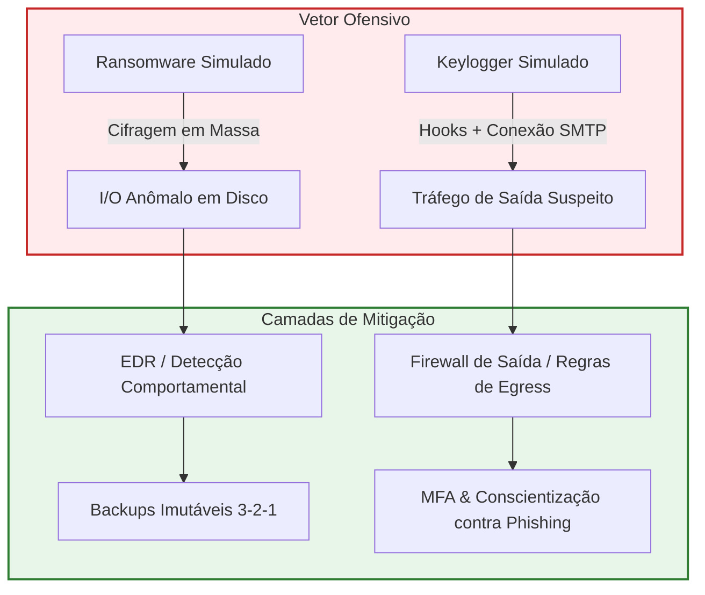

# 🛡️ Desafio Prático: Simulando um Malware de Captura de Dados em Python e Estratégias de Defesa

> **Bootcamp:** Santander Cibersegurança — DIO  
> **Tema:** Desenvolvimento de Artefatos Maliciosos (Ransomware & Keylogger) para Fins Educacionais e Mecanismos Defensivos  
> **Linguagem:** Python 3  
> **Objetivo:** Compreender a anatomia interna de ameaças cibernéticas para desenvolver uma mentalidade analítica de detecção, resposta a incidentes e mitigação.

---

## 📋 Sumário
1. [Apresentação e Escopo do Desafio](#-apresentação-e-escopo-do-desafio)
2. [Módulo 1: Simulação de Ransomware](#-módulo-1-simulação-de-ransomware)
   - [Aulas 01 a 03: Arquitetura, Lógica e Funções](#aulas-01-a-03-arquitetura-lógica-e-funções)
   - [Aulas 04 e 05: Execução Prática e Reversão (Descriptografia)](#aulas-04-e-05-execução-prática-e-reversão-descriptografia)
3. [Módulo 2: Simulação de Keylogger e Exfiltração](#-módulo-2-simulação-de-keylogger-e-exfiltração)
   - [Aulas 06 e 07: Captura de Teclas e Ocultação de Processo](#aulas-06-e-07-captura-de-teclas-e-ocultação-de-processo)
   - [Aulas 08 e 09: Exfiltração Automatizada via SMTP](#aulas-08-e-09-exfiltração-automatizada-via-smtp)
4. [Módulo 3: Mentalidade Defensiva e Mitigações](#-módulo-3-mentalidade-defensiva-e-mitigações)
   - [Aula 10: Estratégias de Detecção e Prevenção](#aula-10-estratégias-de-detecção-e-prevenção)
5. [Estrutura do Projeto Simulado](#-estrutura-do-projeto-simulado)
6. [Boas Práticas e Aviso Legal](#-boas-práticas-e-aviso-legal)

---

## 🎯 Apresentação e Escopo do Desafio

O desafio teve como premissa o conceito de **Segurança Ofensiva com Propósito Defensivo**: construir pequenos scripts controlados em Python para dissecar a mecânica exata utilizada por malwares do tipo *Ransomware* e *Spyware/Keylogger*. 

A prática foi conduzida em ambiente estritamente isolado (`test_files/`), garantindo que nenhum arquivo do sistema operacional fosse colocado em risco.

---

## 🔐 Módulo 1: Simulação de Ransomware

### Aulas 01 a 03: Arquitetura, Lógica e Funções
Nesta etapa, foi modelada a lógica de cifragem simétrica de arquivos utilizando a biblioteca de alto nível `cryptography.fernet` integrada ao módulo nativo `os`.

#### Tecnologias e Bibliotecas:
* `cryptography.fernet.Fernet`: implementação robusta de criptografia simétrica com autenticação (AES-128 em modo CBC com HMAC).
* `os` & `os.walk`: travessia recursiva de diretórios e manipulação do sistema de arquivos.

#### Anatomia das Funções Desenvolvidas:
1. **`gerar_chave()`**: 
   * Gera uma chave criptográfica segura pseudoaleatória de 32 bytes através de `Fernet.generate_key()`.
   * Salva a chave em disco em modo binário (`"wb"`) com o nome `chave.key`.
2. **`carregar_chave()`**: 
   * Lê a chave armazenada em `chave.key` em modo binário (`"rb"`) e instancia o motor `Fernet(chave)`.
3. **`encontrar_arquivos(diretorio_alvo)`**: 
   * Realiza a varredura recursiva de subdiretórios com `os.walk()`.
   * **Trava de Segurança Crítica:** Implementa filtro condicional para ignorar o próprio script (`ransomware.py`) e a chave gerada (`.key`), prevenindo que o artefato corrompa sua própria execução ou destrua a chave de reversão.
4. **`criptografar_arquivo(caminho_arquivo, f)`**: 
   * Lê o arquivo alvo em modo binário (`"rb"`), aplica o método `f.encrypt(dados)` e grava o payload cifrado sobre o arquivo original (`"wb"`).
5. **`criar_mensagem_resgate(diretorio_alvo)`**: 
   * Cria o artefato instrucional de extorsão (`LEIA_ISSO.txt`) detalhando as instruções simuladas de pagamento em criptomoedas.
6. **`main()`**: 
   * Orquestra a execução na ordem estrita: geração/carregamento da chave ➔ mapeamento dos alvos ➔ cifragem em lote ➔ emissão do bilhete de resgate.

---

### Aulas 04 e 05: Execução Prática e Reversão (Descriptografia)

* **Impacto em Tempo de Execução:** Ao disparar `python ransomware.py`, os arquivos alvos no diretório de teste têm seus bytes substituídos imediatamente por sequências ilegíveis codificadas pela cifra Fernet.
* **Mecanismo de Descriptografia (`descriptografar.py`):**
  * Para comprovar a simetria criptográfica e simular a restauração após obtenção da chave, foi elaborado o script inverso.
  * O script carrega `chave.key`, reitera recursivamente sobre os arquivos comprometidos e invoca `f.decrypt(conteudo_cifrado)`, restaurando os arquivos ao seu estado íntegro original.

---

## 🕵️ Módulo 2: Simulação de Keylogger e Exfiltração

### Aulas 06 e 07: Captura de Teclas e Ocultação de Processo

Nesta fase, explorou-se a coleta não autorizada de dados digitados (*keystroke logging*).

#### Componentes e Técnicas:
* **Biblioteca Principal:** `pynput.keyboard` para registro de *hooks* globais do teclado no sistema operacional.
* **Filtros e Tratamento de Exceções:**
  * Criação de um conjunto de teclas descartáveis (`IGNORAR`) contendo modificadores (`Shift`, `Ctrl`, `Alt`, `Caps Lock`, etc.) para manter o log limpo e legível.
  * Tratamento de exceções `AttributeError` para separar teclas alfanuméricas comuns de teclas de ação estrutural (ex: mapeando para `[ENTER]`, `[BACKSPACE]`, `[TAB]` e `[ESC]`).
  * Persistência incremental dos caracteres em arquivo local de log (`log.txt`).
* **Furtividade Operacional (`.pyw`):**
  * Uso do executor `pythonw.exe` ao renomear o arquivo para a extensão `.pyw`. Essa técnica impede a abertura de janelas de terminal ou prompt de comando (GUI oculta), mantendo a execução transparente para o usuário final.

---

### Aulas 08 e 09: Exfiltração Automatizada via SMTP

Avanço da ameaça simulada para a fase de **exfiltração remota de dados**, sem depender do acesso físico à máquina da vítima para recuperar os logs.

#### Mecânica de Implementação:
* **Bibliotecas:** `smtplib`, `email.mime.text.MIMEText`, `email.mime.multipart.MIMEMultipart` e `threading.Timer`.
* **Configuração de Autenticação Segura:**
  * Uso de conta dedicada de testes.
  * Configuração de **2FA (Autenticação em Dois Fatores)** e emissão de **Senha de Aplicativo (App Passwords)** para atender às diretrizes TLS do provedor de e-mail.
* **Disparo Cíclico Assíncrono:**
  * Implementação de uma rotina temporizada (`threading.Timer`) com intervalos programados (ex: a cada 60 segundos).
  * O script lê o conteúdo de `log.txt`, empacota os dados em um e-mail formatado via protocolo SMTP (porta TLS 587) e os despacha para a caixa de entrada do atacante, limpando o buffer local na sequência.

---

## 🛡️ Módulo 3: Mentalidade Defensiva e Mitigações

### Aula 10: Estratégias de Detecção e Prevenção

O fechamento do desafio focou na transição da perspectiva do atacante para a postura analítica do profissional de segurança (Blue Team / SOC / EDR):



### Principais Pilares Defensivos:
1. **Detecção Comportamental (EDRs/XDRs):**
   * Em vez de confiar apenas em assinaturas estáticas de antivírus (que podem ser burladas facilmente), os sensores analisam padrões: alta taxa de modificação/substituição de arquivos em curto espaço de tempo e criação de processos não interativos em segundo plano.
2. **Controle de Tráfego de Saída (Egress Filtering):**
   * Bloqueio ou restrição de portas SMTP (25, 465, 587) originadas de estações de trabalho não autorizadas, impedindo a exfiltração direta por scripts desconhecidos.
3. **Estratégia Robusta de Backup (Regra 3-2-1):**
   * Manter backups offline (*air-gapped*) e cópias imutáveis em nuvem, garantindo capacidade de recuperação imediata sem negociação de resgates.
4. **Hardening e Conscientização:**
   * Restrição de execução de scripts não assinados via políticas de grupo (GPO / AppLocker) e conscientização contínua dos usuários contra vetores de infecção primária (phishing e engenharia social).

---

## 📂 Estrutura do Projeto Simulado

```text
desafio-malware-python/
│
├── README.md               # Documentação detalhada do desafio e aulas
│
├── modulo_ransomware/
│   ├── ransomware.py       # Script de varredura e cifragem simétrica
│   ├── descriptografar.py  # Script de recuperação/reversão dos dados
│   └── test_files/         # Diretório controlado para testes de infecção
│       ├── doc_financeiro.txt
│       └── relatorio.txt
│
└── modulo_keylogger/
    ├── keylogger.py        # Capturador de teclas com persistência local
    ├── keylogger_stealth.pyw # Versão sem interface de terminal
    └── exfiltrador_smtp.py # Módulo integrado com envio cíclico via SMTP
```

---

## ⚠️ Aviso Legal

> **Nota Ética e Educacional:**  
> Os conceitos, códigos e simulações descritos neste documento destinam-se exclusivamente para fins didáticos, pesquisas de segurança da informação e compreensão de técnicas defensivas no contexto do **Bootcamp Santander Cibersegurança** na plataforma **DIO**. A execução de qualquer técnica de ataque em redes, equipamentos ou sistemas sem autorização prévia e expressa constitui crime previsto na legislação vigente (Lei 12.737/2012 - Lei Carolina Dieckmann e Art. 154-A do Código Penal Brasileiro).
